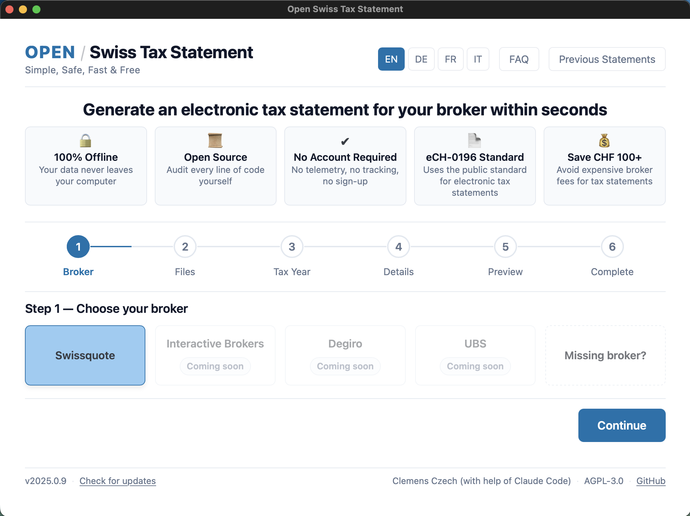

# Open Swiss Tax Statement

[](https://github.com/einwienerli/open-swiss-tax-statement/actions/workflows/lint.yml)
[](https://github.com/einwienerli/open-swiss-tax-statement/actions/workflows/test.yml)
[](https://github.com/einwienerli/open-swiss-tax-statement/actions/workflows/offline.yml)

**Simple. Safe. Fast. Free.**

Generate an official electronic tax statement (E-Steuerauszug) from your broker's free exports — no account, no upload, no cost.

The output is a barcode-enabled PDF you can import directly into your cantonal tax portal — the same format some brokers charge up to CHF 100 to produce.

<p align="center">
  
</p>

## How It Works

1. **Export** your transactions and portfolio from your broker (free)
2. **Generate** — the app enriches your data with official ESTV tax values and exchange rates
3. **Import** the PDF into your cantonal tax portal (e.g. ZHprivateTax)

## Download

Download the latest `.dmg` from [**Releases**](https://github.com/einwienerli/open-swiss-tax-statement/releases) and drag the app to Applications.

> **First launch:** The app is unsigned. macOS will block it on first open.
> Go to **System Settings → Privacy & Security** and click **Open Anyway**. Required once only.

Want to run from source or build the app yourself? See [For Developers](#for-developers) below.

## Features

| | |
|---|---|
| **Brokers** | Swissquote (CSV, Kontoauszug PDF, Portfolio PDF) — more planned |
| **Assets** | Stocks, ETFs, funds, bonds, structured products, multi-currency cash |
| **Languages** | English, German, French, Italian |

Something missing? [Open an issue](https://github.com/einwienerli/open-swiss-tax-statement/issues) or [get in touch](https://github.com/einwienerli). Attaching the app log (`~/Documents/OpenSwissTaxStatement/app.log`) helps — it only contains technical metadata, never personal data.

## Security & Privacy

**Fully offline.** No network requests during normal use. Parsing, enrichment, and PDF generation all run locally.

**No telemetry.** No analytics, tracking, crash reporting, or data collection of any kind.

**Data stays on your machine.** Statements are stored in `~/Documents/OpenSwissTaxStatement/`. Delete the folder to remove all traces.

**Update checks are opt-in.** "Check for updates" in the footer sends a single request to the GitHub API — no personal data. If you never click, the app stays fully offline.

**Independently verifiable.** An automated [offline test](tests/test_offline.py) scans the entire source tree for network-capable imports on every commit. See the "100% Offline" badge above.

## License

[AGPL-3.0](LICENSE) — free to use, modify, and distribute. Modified versions and hosted services must publish their source code under the same license.

---

<details>
<summary><strong>For Developers</strong></summary>

### Run from Source

Requires Python 3.11+. No native dependencies.

```bash
git clone https://github.com/einwienerli/open-swiss-tax-statement.git
cd open-swiss-tax-statement
pip install -e ".[dev]"

python run.py          # Launch the app
python run.py --debug  # Launch with developer tools
```

### Build

```bash
bash scripts/build.sh      # Build .app bundle (requires PyInstaller)
bash scripts/build_dmg.sh  # Create .dmg from built .app
```

### Tests

```bash
pytest    # 600+ tests covering the full pipeline
```

### Project Structure

```
src/
├── models/          # Domain model (TaxStatement, Security, Holding, etc.)
├── parsers/
│   └── swissquote/  # CSV, Kontoauszug PDF, Portfolio PDF parsers
├── enrichment/      # ICTAX Kursliste, ESTV exchange rates, rounding
├── generators/
│   ├── ech0196/     # eCH-0196 v2.2 XML builder + XSD validator
│   ├── barcode/     # CODE128C + Macro PDF417 barcode generation
│   └── pdf/         # PDF assembly (reportlab + pypdf)
├── ui/              # pywebview desktop UI (HTML/CSS/JS + Python API)
└── admin/           # Year-end data preparation tools
```

### Adding a New Tax Year

Each release bundles ICTAX Kursliste data for the covered tax years. To add a new year:

1. Download the Kursliste V2.2 XML from [ICTAX](https://www.ictax.admin.ch)
2. Run `python -m src.admin.prepare_year --year YYYY --kursliste /path/to/kursliste.xml`

### Technical Details

- eCH-0196 v2.2 XML output, validated against official XSD schemas
- Barcodes per eCH-0196 Technische Wegleitung (CODE128C + Macro PDF417)
- Tax values in CHF using ESTV exchange rates with DIN 1333 rounding
- Verified against the Zurich cantonal tax portal (ZHprivateTax)
- Tested with a limited number of Swissquote portfolios (stocks, ETFs, cash). Other eCH-0196 cantons should work but have not been confirmed. Always review before submitting.

</details>
